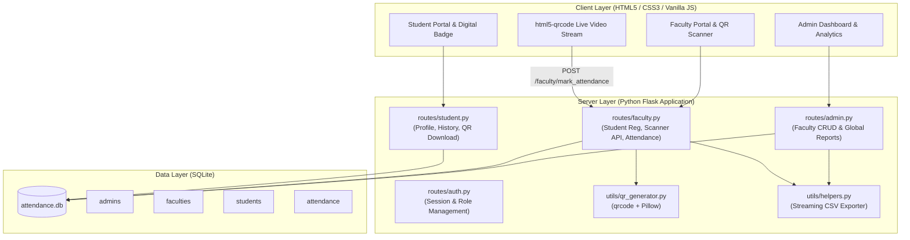
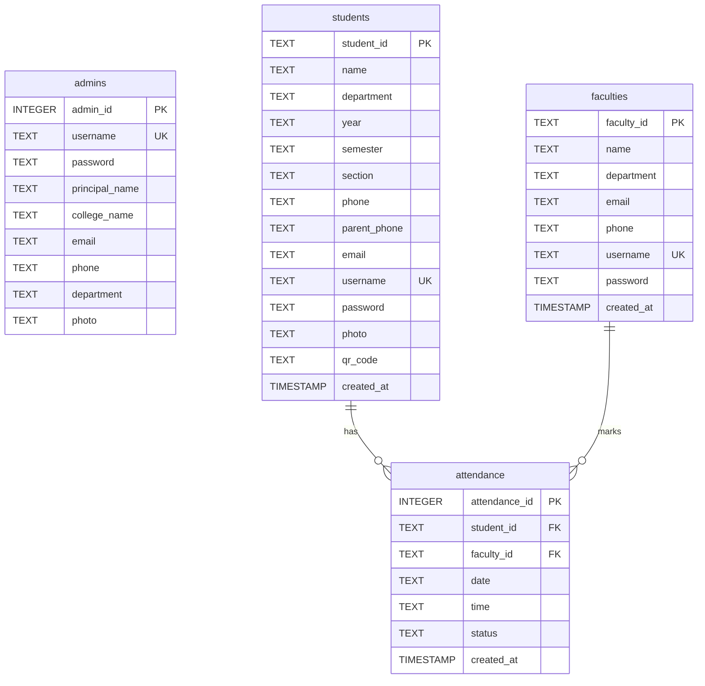
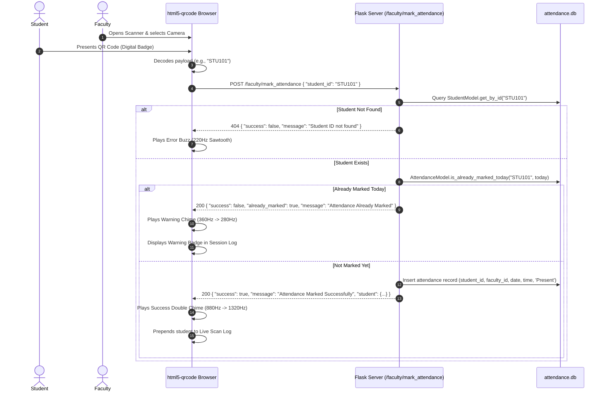

# 🎓 Smart Student Attendance System (QR Code Based)

[](https://www.python.org/)
[](https://flask.palletsprojects.com/)
[](https://www.sqlite.org/)
[](https://developer.mozilla.org/)
[](LICENSE)

A production-quality, responsive, and secure **Smart Student Attendance System** powered by **Python Flask**, **SQLite**, and **Vanilla HTML5/CSS3/JavaScript**. 

This system automates classroom attendance using **dynamic QR codes**, providing real-time camera scanning via [`html5-qrcode`](https://github.com/mebjas/html5-qrcode), duplicate attendance prevention for current sessions, instant Web Audio auditory feedback, interactive HTML5 Canvas analytics, and multi-role dashboards for **College Administrators (Principals)**, **Faculty**, and **Students**.

---

## 📑 Table of Contents

- [Executive Overview](#-executive-overview)
- [System Architecture](#-system-architecture)
- [Key Features by Role](#-key-features-by-role)
  - [1. College Admin Panel](#1-college-admin-panel-principaladmin)
  - [2. Faculty Panel](#2-faculty-panel)
  - [3. Student Panel](#3-student-panel)
- [Technology Stack](#-technology-stack)
- [Database Schema & ER Diagram](#-database-schema--er-diagram)
- [Directory Structure & Module Breakdown](#-directory-structure--module-breakdown)
- [Installation & Setup Guide](#-installation--setup-guide)
- [Default Demo Credentials](#-default-demo-credentials)
- [QR Attendance Flow & Logic](#-qr-attendance-flow--logic)
- [Interactive Canvas Charts (Zero External Dependencies)](#-interactive-canvas-charts)
- [API Reference](#-api-reference)
- [Testing & Quality Assurance](#-testing--quality-assurance)
- [Troubleshooting & FAQs](#-troubleshooting--faqs)
- [License & Acknowledgments](#-license--acknowledgments)

---

## 💡 Executive Overview

Traditional attendance marking by calling roll numbers or passing physical paper sheets is time-consuming, prone to proxy attendance, and difficult to audit. 

The **Smart Student Attendance System** solves these challenges by:
1. **Automating QR Code Issuance**: When a faculty member registers a student, a high-resolution, individualized QR code is generated instantly using Python's `qrcode` library and Pillow.
2. **Contactless Live Camera Scanning**: Faculty can open their laptop or mobile camera via `html5-qrcode` to scan student QR codes in fractions of a second.
3. **Session-Level Duplicate Prevention**: The system enforces daily attendance constraints. If a student's badge is scanned more than once on the same date, the system immediately flags **"Attendance Already Marked"** with distinct warning sounds.
4. **Accessible Student Self-Service**: Students can view their attendance percentage, verify if they meet the 75% eligibility threshold, and download high-resolution PNG copies of their QR badge to their smartphones.
5. **Universal Login Support**: Students can log in using either their system-assigned **Username** or their registered **Gmail/Email Address**.

---

## 🏗️ System Architecture



---

## 🎯 Key Features by Role

### 1. College Admin Panel (Principal/Admin)
* **Real-time Overview Dashboard**:
  * Stat cards: **Total Faculties**, **Total Students**, **Total Classes**, and **Today's Attendance Rate**.
  * Interactive Canvas Charts: **Class-wise Turnout (Bar Chart)**, **7-Day Attendance Trends (Line Chart)**, and **Monthly Turnout**.
  * Live feed of recent campus-wide attendance check-ins.
* **Faculty Management (Full CRUD)**:
  * Add faculty with auto-hashed passwords (`werkzeug.security`).
  * Edit faculty profile, department, email, phone, and credentials.
  * Delete faculty members with confirmation safeguards.
* **Student Directory & Class Filter**:
  * View all registered students across departments.
  * Search by Student ID, Name, or Email.
  * Filter dynamically by Department, Academic Year, and Class Section.
  * Inspect full student profile modal with digital QR badges.
* **Campus Attendance Audit**:
  * Filter attendance records by Date, Department, Academic Year, and Student ID.
* **Reports & CSV Exports**:
  * Generate **Daily**, **Weekly (Last 7 Days)**, and **Monthly** attendance audit reports.
  * Download structured CSV files directly to device.
* **Principal Profile**:
  * View/edit Principal Name, College Name, Email, Phone, Department, and passport photo upload.

---

### 2. Faculty Panel
* **Faculty Dashboard**:
  * Metrics: **Today's Total Students**, **Present**, **Absent**, and **Attendance Percentage**.
  * Quick-launch buttons: *Launch QR Scanner*, *Register Student*, *Students Directory*, *Attendance*, *Reports*.
  * Real-time list of today's attendance check-ins marked by this faculty.
* **Student Registration**:
  * Enrolls student with fields: *Student ID, Full Name, Department, Academic Year, Semester, Section, Phone, Student Gmail, Parent Phone, Username, Password, and Passport Photo*.
  * Automatically creates a high-contrast QR PNG in `static/qr_codes/{student_id}.png`.
  * Generates login credentials allowing students to sign in using their username or Gmail.
* **Live Camera QR Scanner**:
  * Runs [`html5-qrcode`](https://github.com/mebjas/html5-qrcode) directly in browser using laptop/mobile cameras.
  * Camera device selection switcher (front/back/external webcams).
  * Sub-second verification via asynchronous POST endpoint `/faculty/mark_attendance`.
  * **Duplicate Attendance Prevention**: Flags students already scanned today with **"Attendance Already Marked"**.
  * **Web Audio Synthesis**:
    * 🎵 High double chime (`880Hz -> 1320Hz`) on successful attendance mark.
    * ⚠️ Low tone (`360Hz -> 280Hz`) on duplicate attempt.
    * ❌ Sawtooth buzz (`220Hz`) on invalid/unrecognized IDs.
  * Live scanned session table prepending newly checked-in students in real time.
  * Manual ID fallback input for testing or barcode reader peripherals.
* **Student Management**:
  * View, search, filter, edit student credentials/information, or remove student records.
* **Attendance & Reports**:
  * Search attendance logs and export Daily/Weekly/Monthly attendance sheets to CSV.

---

### 3. Student Panel
* **Student Dashboard**:
  * Profile card showing passport photo, Full Name, Student ID, Department, Year, Semester, Section, and contact numbers.
  * Attendance analytics card highlighting:
    * Total college session days recorded.
    * Verified attended days.
    * Net attendance percentage with visual color status (Green for $\ge 75\%$, Red for $< 75\%$).
    * Today's status chip (**Present** with timestamp or **Not Checked In Today**).
* **Digital QR Badge**:
  * View personal QR code.
  * **Download QR Code (PNG)** button for offline presentation from mobile screens.
* **Attendance History**:
  * Complete chronological log of check-in timestamps, dates, and marking faculty.
* **Profile Management**:
  * Edit Phone, Parent Phone, Email/Gmail, Password, and passport photo.
  * Immutable Student ID preventing identity spoofing.

---

## 🛠️ Technology Stack

| Layer | Technology | Details / Purpose |
|---|---|---|
| **Frontend** | **HTML5 & CSS3** | Modern dark sidebar layout, CSS custom properties (variables), responsive flex/grid layouts. |
| **Frontend Scripts** | **Vanilla JavaScript** | Zero external frameworks (No React, Angular, Vue, or Bootstrap). |
| **Canvas Charts** | **HTML5 Canvas 2D API** | Custom retina High-DPI bar and line chart engine built from scratch. |
| **QR Scanning** | **html5-qrcode** | Client-side JavaScript video feed scanning library (bundled locally for offline reliability). |
| **Backend** | **Python Flask 3.x** | Modular Blueprints architecture (`auth`, `admin`, `faculty`, `student`). |
| **Database** | **SQLite3** | Embedded relational database with foreign key enforcement and row factory. |
| **QR Generation** | **qrcode & Pillow (PIL)** | Python library producing error-corrected (`ERROR_CORRECT_H`) QR PNG files. |
| **Security** | **Werkzeug Security** | Salted cryptographic password hashing via `generate_password_hash` & `check_password_hash`. |
| **Data Export** | **Python csv module** | Dynamic in-memory streaming CSV file generator (`io.StringIO`). |

---

## 🗄️ Database Schema & ER Diagram



---

## 📁 Directory Structure & Module Breakdown

```
SmartStudentAttendance/
├── app.py                      # Application factory, blueprint registrations, error handlers
├── database.py                 # SQLite initialization, schema definition, and automatic demo seeder
├── attendance.db               # SQLite database file (created automatically on startup)
├── test_app.py                 # Comprehensive automated unit test suite (7 test suites)
├── requirements.txt            # Python dependencies (Flask, qrcode, Pillow, werkzeug)
├── README.md                   # Complete architectural guide & documentation
├── .gitignore                  # Git ignore rules for virtual environments, pycache, and temp files
│
├── models/
│   ├── __init__.py
│   └── models.py               # Data Access Object (DAO) classes: AdminModel, FacultyModel,
│                               # StudentModel, AttendanceModel
│
├── routes/
│   ├── __init__.py
│   ├── auth.py                 # Session authentication, login tabs, logout
│   ├── admin.py                # Admin dashboard, faculty CRUD, student view, reports, profile
│   ├── faculty.py              # Faculty dashboard, student enrollment, scanner API, attendance
│   └── student.py              # Student portal, QR code download, profile update, history
│
├── utils/
│   ├── __init__.py
│   ├── helpers.py              # Auth decorators (@login_required, @role_required),
│   │                           # streaming CSV response helper, date/time formatters
│   └── qr_generator.py         # Python qrcode generation with high error-correction
│
├── templates/
│   ├── base.html               # Master layout: dark sidebar, sticky header, alert toasts, modal helpers
│   ├── login.html              # Multi-role switchable login with demo credential hints
│   ├── admin_dashboard.html    # Admin metrics, Canvas line/bar charts, recent activity feed
│   ├── faculty_dashboard.html  # Faculty metrics, quick-action navigation, scan history
│   ├── student_dashboard.html  # Student profile, attendance rate, QR preview & PNG download
│   ├── register_student.html   # Student registration form with live photo preview
│   ├── scanner.html            # html5-qrcode video viewfinder, device selector, audio feedback
│   ├── students.html           # Searchable student directory with filters & edit/view modals
│   ├── faculty_management.html # Faculty CRUD management table & modal dialogs
│   ├── attendance.html         # Filterable attendance audit table (date/dept/class)
│   ├── reports.html            # Daily/Weekly/Monthly attendance summaries & CSV exporter
│   └── profile.html            # Personal profile view and editor
│
└── static/
    ├── css/
    │   └── style.css           # Pure CSS3 stylesheet: dark sidebar (#0f172a), blue primary (#2563eb),
    │                           # modern typography, modal overlays, responsive breakpoints
    ├── js/
    │   ├── main.js             # Mobile sidebar drawer, auto-dismissing toasts, Canvas chart engines
    │   ├── scanner.js          # html5-qrcode wrapper, Web Audio API chime generator, AJAX scan handler
    │   └── html5-qrcode.min.js # Standalone bundled copy of html5-qrcode for offline execution
    ├── images/
    │   └── default_avatar.png  # Fallback user avatar
    ├── qr_codes/               # Output directory for generated student QR PNG images
    ├── uploads/                # Directory for uploaded student and administrator photos
    └── exports/                # Output directory for temporary exported data
```

---

## ⚡ Installation & Setup Guide

### 1. Prerequisites
* **Python 3.10** or higher installed ([Download Python](https://www.python.org/downloads/)).
* **Git** installed on your system.
* A web browser (Google Chrome, Mozilla Firefox, Microsoft Edge, or Safari) with camera permissions enabled.

### 2. Clone the Repository
```bash
git clone https://github.com/kadaliadithya123-dot/Smart-Student-Attendance-System-QR-Code-Based-.git
cd Smart-Student-Attendance-System-QR-Code-Based-
```

### 3. Create and Activate a Virtual Environment

**On Windows (PowerShell):**
```powershell
python -m venv venv
.\venv\Scripts\Activate.ps1
```

**On Linux / macOS:**
```bash
python3 -m venv venv
source venv/bin/activate
```

### 4. Install Dependencies
```bash
pip install -r requirements.txt
```

### 5. Initialize the Database
The database initializes and seeds itself automatically upon the first run of `app.py`. If you want to explicitly run initialization:
```bash
python database.py
```
*This creates all tables, seeds the administrator, sample faculty, and demo students, and pre-generates QR code image badges in `static/qr_codes/`.*

### 6. Run the Application
```bash
python app.py
```
Open your browser and navigate to:
```
http://127.0.0.1:5000
```

---

## 🔑 Default Demo Credentials

The system comes pre-seeded with ready-to-test accounts for every role:

| Role | Username / Identifier | Password | Name / Department | Features Accessible |
|---|---|---|---|---|
| 👑 **College Admin** | `admin` | `admin123` | Dr. Ramesh Kumar (Principal) | Full Analytics, Faculty CRUD, Student Directory, CSV Export, Profile |
| 👨‍🏫 **Faculty** | `anita_fac` | `faculty123` | Dr. Anita Sharma (Computer Science) | Camera QR Scanner, Student Registration, Class Attendance Logs, Reports |
| 👨‍🏫 **Faculty** | `vikram_fac` | `faculty123` | Prof. Vikram Verma (ECE) | Camera QR Scanner, Student Registration, Class Attendance Logs, Reports |
| 🎓 **Student** | `rahul101` *or* `rahul.verma@gmail.com` | `student123` | Rahul Verma (CSE - 3rd Year) | Personal Profile, 75% Attendance Metric, QR Download (PNG), History |
| 🎓 **Student** | `priya102` *or* `priya.patel@gmail.com` | `student123` | Priya Patel (CSE - 3rd Year) | Personal Profile, 75% Attendance Metric, QR Download (PNG), History |
| 🎓 **Student** | `amit103` *or* `amit.singh@gmail.com` | `student123` | Amit Singh (ECE - 2nd Year) | Personal Profile, 75% Attendance Metric, QR Download (PNG), History |

> 💡 **Tip:** On the login screen, click the **Admin**, **Faculty**, or **Student** tabs to switch roles. The login helper box dynamically displays the relevant demo login credentials for quick testing.

---

## 🔄 QR Attendance Flow & Logic



---

## 📊 Interactive Canvas Charts

The application enforces a strict **zero-dependency philosophy** for visualizations:
* **No Chart.js, no D3.js, no external CDNs**.
* Built using the native HTML5 Canvas 2D Rendering Context in `static/js/main.js`.
* Automatically queries screen pixel density (`window.devicePixelRatio`) to render razor-sharp graphics on Retina and 4K displays.
* **Bar Chart (`AttendanceCharts.drawBarChart`)**: Draws rounded-corner bars, automatic Y-axis interval scaling, and clean value badges.
* **Line Chart (`AttendanceCharts.drawLineChart`)**: Renders linear attendance progression curves with soft translucent vertical fill gradients and data dots.

---

## 📡 API Reference

### 1. Mark Attendance (Live Scanner)
* **URL**: `/faculty/mark_attendance`
* **Method**: `POST`
* **Access**: Faculty session required
* **Headers**: `Content-Type: application/json`
* **Request Body**:
  ```json
  {
    "student_id": "STU101"
  }
  ```
* **Success Response (`200 OK`)**:
  ```json
  {
    "success": true,
    "already_marked": false,
    "message": "Attendance Marked Successfully",
    "student": {
      "student_id": "STU101",
      "name": "Rahul Verma",
      "department": "Computer Science",
      "year": "3rd Year",
      "section": "A",
      "date": "2026-10-13",
      "time": "09:14:22"
    }
  }
  ```
* **Duplicate Response (`200 OK`)**:
  ```json
  {
    "success": false,
    "already_marked": true,
    "message": "Attendance Already Marked",
    "student": {
      "student_id": "STU101",
      "name": "Rahul Verma",
      "department": "Computer Science"
    }
  }
  ```
* **Invalid Student (`404 Not Found`)**:
  ```json
  {
    "success": false,
    "message": "Student ID 'STU999' not found in database."
  }
  ```

---

### 2. Export Attendance to CSV
* **URL**: `/admin/reports/export` or `/faculty/reports/export`
* **Method**: `GET`
* **Query Parameters**:
  * `type`: `daily` | `weekly` | `monthly`
  * `date`: `YYYY-MM-DD` (Target reference date)
  * `department`: *(Optional)* Department name filter
* **Response**: Direct file download (`Content-Type: text/csv`) with filename formatted as `{role}_{type}_report_{timestamp}.csv`.

---

### 3. Student QR Download
* **URL**: `/student/download_qr`
* **Method**: `GET`
* **Access**: Student session required
* **Response**: Binary PNG download attachment named `{student_id}_QRCode.png`.

---

## 🧪 Testing & Quality Assurance

The codebase includes an automated unit test suite in `test_app.py` validating all business logic, role authentications, QR code creation, duplicate detection, and streaming CSV exports:

```bash
python test_app.py
```

### Test Suite Execution Output:
```text
Ran 7 tests in 2.041s

OK
```

| Test Case | Description | Result |
|---|---|---|
| `test_01_login_page_renders` | Confirms login template renders with all 3 role selectors | **PASSED** |
| `test_02_admin_login_and_dashboard` | Authenticates administrator and checks dashboard statistics | **PASSED** |
| `test_03_student_login_with_gmail` | Validates student authentication using Gmail and password | **PASSED** |
| `test_04_student_qr_download` | Checks PNG attachment headers and student badge file validity | **PASSED** |
| `test_05_faculty_scanner_and_duplicate_prevention` | Tests valid check-in, duplicate detection, and 404 on invalid IDs | **PASSED** |
| `test_06_faculty_register_student_and_qr_generation` | Enrolls student, verifies auto-generated QR PNG on disk, and logs in | **PASSED** |
| `test_07_csv_reports_export` | Verifies dynamic CSV streaming headers and row records | **PASSED** |

---

## ❓ Troubleshooting & FAQs

### 1. Camera permission is blocked or not showing in the scanner
* **Solution**: Modern browsers require either `http://localhost`, `http://127.0.0.1`, or `https://` to permit webcam access. When testing locally, access the app via `http://127.0.0.1:5000`. Ensure you click **"Allow"** when prompted for camera access.
* **Testing without camera**: Use the built-in **"Manual Student ID Entry"** form directly under the scanner card to test attendance marking without a webcam.

### 2. Audio chimes do not play on scan
* **Solution**: Web browsers mute audio by default until the user interacts with the page. Clicking "Start Scanner" or anywhere on the page unlocks the Web Audio API context.

### 3. I forgot the password of a pre-seeded account
* **Solution**: You can reset or re-seed the SQLite database at any time by deleting `attendance.db` and running `python database.py`.

---

## 📄 License & Acknowledgments

* **License**: Distributed under the [MIT License](LICENSE).
* **Library Acknowledgments**:
  * [html5-qrcode](https://github.com/mebjas/html5-qrcode) by Minhaz Himel for the QR scanner engine.
  * [qrcode](https://github.com/lincolnloop/python-qrcode) for Python QR code generation.
  * [Pillow (PIL Fork)](https://python-pillow.org/) for image processing.
  * [Flask](https://palletsprojects.com/p/flask/) by the Pallets Projects.

---

**Developed with ❤️ for Academic Institutions and Universities.**
